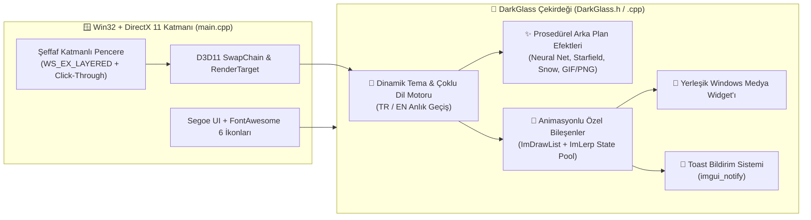

<div align="center">

# 🌌 DarkGlass ImGui UI Framework

**C++ ve DirectX 11 İçin Glassmorphism Efektli, Özel Animasyonlu Bileşenler, Parçacık Arka Planlar ve Medya Kontrolcüsü İçeren Modern Dear ImGui Arayüz Çatısı**  
*A Modern Glassmorphic Dear ImGui Component Library & Studio Overlay Framework for C++ and DirectX 11*

[](https://isocpp.org/)
[](https://learn.microsoft.com/en-us/windows/win32/direct3d11/atoc-dx-graphics-direct3d-11)
[](https://github.com/ocornut/imgui)
[](LICENSE)

</div>

---

## 🌟 Genel Bakış (Overview)

**DarkGlass ImGui Framework**, standart **Dear ImGui** arayüzlerini modern masaüstü stüdyo yazılımları, 3D oyun motoru hata ayıklama panelleri (Engine Debuggers) ve donanım telemetri katmanları (Performance Overlays) için **yüksek estetikli bir Glassmorphism (buzlu cam) tasarım sistemine** dönüştüren C++ / DirectX 11 kütüphanesidir.

Standart ImGui kontrollerinin yerine `ImDrawList` üzerinde sıfırdan çizilen, **`ImLerp` interpolasyonlu mikro-animasyonlara** sahip özel bileşenler (`CustomCheckbox`, `CustomSliderFloat`, `CustomCombobox`, `CustomMultiCombobox`, `KeybindBox`, `CustomProgressBar`) ve yerleşik parçacık simülasyonları sunar.

---

## 🏗️ Mimari (Architecture)



---

## ✨ Öne Çıkan Özellikler (Key Features)

- **🧩 Özel Animasyonlu Widget Havuzu (`m_AnimationState`):**
  - `CustomCheckbox`: Yumuşak renk geçişli anahtar ve entegre kısayol tuşu (`KeybindBox`) bağlama.
  - `CustomSliderFloat`: Parlayan vurgu çubuğu ve dinamik değer baloncuğu.
  - `CustomCombobox` & `CustomMultiCombobox`: Çoklu seçim destekli, yumuşak açılır menüler.
  - `CustomProgressBar`: GPU, VRAM ve Shader derleme durumları için akıcı ilerleme çubukları.
- **✨ 4 Farklı Arka Plan ve Medya Motoru:**
  - **Neural Network:** Birbirine dinamik çizgilerle bağlanan düğüm ağı simülasyonu.
  - **Starfield & Snow:** 3B derinlik algılı yıldız kümesi ve kar yağışı efektleri.
  - **GIF / Görsel Desteği (`stb_image`):** Çok kareli animasyonlu `.gif` veya `.png`/`.jpg` duvar kağıtlarını DirectX 11 dokusu (`ID3D11ShaderResourceView`) olarak oynatma.
- **🎨 5 Dinamik Renk Teması & Çoklu Dil (TR / EN):**
  - *Purple, Blue, Red, White, Gray* vurgu paletleri ve ekran kararma geçişiyle (fade transition) Türkçe / İngilizce dil değişimi.
- **🎵 Entegre Medya Kontrol Widget'ı:**
  - Ana pencereye kenetlenebilen (dockable) veya bağımsız taşınabilen, Windows medya tuşlarını (`VK_MEDIA_PLAY_PAUSE`, `NEXT`, `PREV`) kontrol eden mini oynatıcı.
- **🪟 Akıllı Click-Through (Tıklama Geçirgenliği):**
  - Fare arayüzün dışındayken arka plandaki pencerelere tıklanabilmesini sağlayan dinamik `WS_EX_TRANSPARENT` yönetimi.

---

## 📂 Proje Dizini (Project Structure)

```text
DarkGlass-ImGui-Framework/
├── DarkGlass.h                  # Tema sabitleri, durum yönetimi ve özel bileşen sınıf tanımları
├── DarkGlass.cpp                # Özel ImDrawList widget çizimleri, efektler ve örnek Stüdyo/Motor panelleri
├── main.cpp                     # Win32 şeffaf pencere ve DirectX 11 başlatma döngüsü
├── imgui_notify.h               # Sağ alt köşe animasyonlu Toast bildirim başlığı
├── IconsFontAwesome6.h          # FontAwesome 6 ikon makro tanımları
├── stb_image.h                  # PNG/JPG ve çok kareli GIF çözücü
├── imgui/                       # Dear ImGui çekirdek ve Win32/DX11 arka uç dosyaları
├── Configs/                     # JSON tabanlı profil kayıt dizini
└── build.bat                    # MSVC (cl.exe) ile tek tıkla derleme betiği
```

---

## 🚀 Derleme ve Çalıştırma (Build & Run)

### Ön Koşullar
- **Windows 10 / 11**
- **Visual Studio 2022** (Desktop development with C++ iş yükü ve Windows SDK)

### Tek Tıkla Derleme
Proje dizinindeki `build.bat` dosyasını çalıştırarak doğrudan `DarkGlass_UI.exe` çıktısını üretebilirsiniz:
```bat
.\build.bat
```

---

## 📄 Lisans (License)

Bu proje **MIT Lisansı** altında açık kaynak olarak sunulmuştur.
